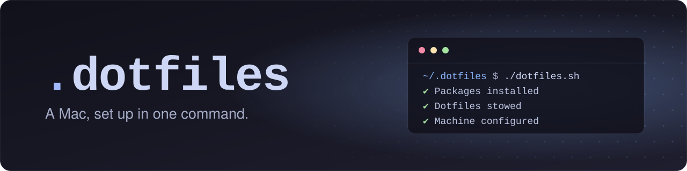

<p align="center">
  
</p>

<p align="center">
  <a href="https://www.apple.com/macos"></a>
  <a href="https://fedoraproject.org/kde/"></a>
  <a href="https://www.gnu.org/software/stow/"></a>
  <a href="https://github.com/TWinston-66/.dotfiles/releases"></a>
  <a href="LICENSE"></a>
</p>

<p align="center">
  <b>A Mac or a Fedora laptop, set up in one command.</b><br>
  Ghostty, tmux, zsh and Zed in Gruvbox Material, plus the packages and system settings around them.
</p>

## Why these dotfiles

- **One command per machine.** `bootstrap.sh` clones the repo and runs `dotfiles.sh`,
  which works out whether it's on macOS or Fedora and does the rest. It's safe to re-run:
  anything already installed or set is skipped.
- **Nothing gets lost.** Any file Stow would replace is moved to `~/.dotfiles-backup/`
  first, in a folder stamped with the date.
- **Edits apply live.** Configs are symlinked rather than copied, so a change takes
  effect without re-running anything.

Everything that takes colours wears Gruvbox Material with a blue accent: Ghostty, tmux,
the prompt, fzf, syntax highlighting, delta, bat, lazygit, btop, Zed, the macOS accent
and KDE Plasma.

Runs on Apple Silicon Macs and on Fedora with KDE Plasma.

## Install

```sh
curl -fsSL https://raw.githubusercontent.com/TWinston-66/.dotfiles/main/bootstrap.sh | bash
```

This clones the repo to `~/.dotfiles` (override with `DOTFILES_DIR`) and runs
`dotfiles.sh`. On Fedora, install git first if it's missing: `sudo dnf install git-core`.

## What it does

**On macOS**

1. Installs the Xcode Command Line Tools, Homebrew and `packages/Brewfile`, plus Claude Code and pi.
2. Links the configs with Stow.
3. Installs tmux's plugins.
4. Sets zsh as the login shell.
5. Applies system defaults, the display layout and Touch ID for `sudo`.

**On Fedora (KDE Plasma)**

1. Installs `packages/fedora.txt` with dnf (Ghostty and gping from COPR) and
   `packages/flathub.txt` from Flathub, and enables Tailscale.
2. Installs what Fedora doesn't package from upstream: starship, lazygit, lazydocker,
   sesh, gitmux, Zed, the Symbols Nerd Font, Claude Code, pi and Criterion.
3. Installs the udev rule that lets Chromium reach the keyboard for VIA.
4. Links the configs with Stow, installs tmux's plugins and sets zsh as the login shell.
5. Applies KDE settings: the Gruvbox Material colour scheme, key repeat, no hot corner,
   Dolphin, Spectacle, a 24-hour clock, Ghostty as the terminal and Okular's jump back to Zed.

## Configs

bat, btop, ghostty, git, gitmux, lazygit, pi, sesh, ssh, starship, tealdeer, tmux, zed
and zsh, each a Stow package laid out like `$HOME`. The `macos` and `fedora` packages
hold the few files that differ by OS (Ghostty's keys, the LaTeX viewer), and only the
current OS's is linked. Rectangle's config is copied in rather than linked, since
Rectangle imports and renames its file; KDE's settings are written with `kwriteconfig6`
for the same reason.

## Update

```sh
~/.dotfiles/dotfiles.sh                # re-link configs and re-run setup
brew update && brew upgrade            # macOS packages
sudo dnf upgrade && flatpak update     # Fedora packages
```

Bumping `VERSION` on `main` publishes a GitHub release.

## License

[MIT](LICENSE)
